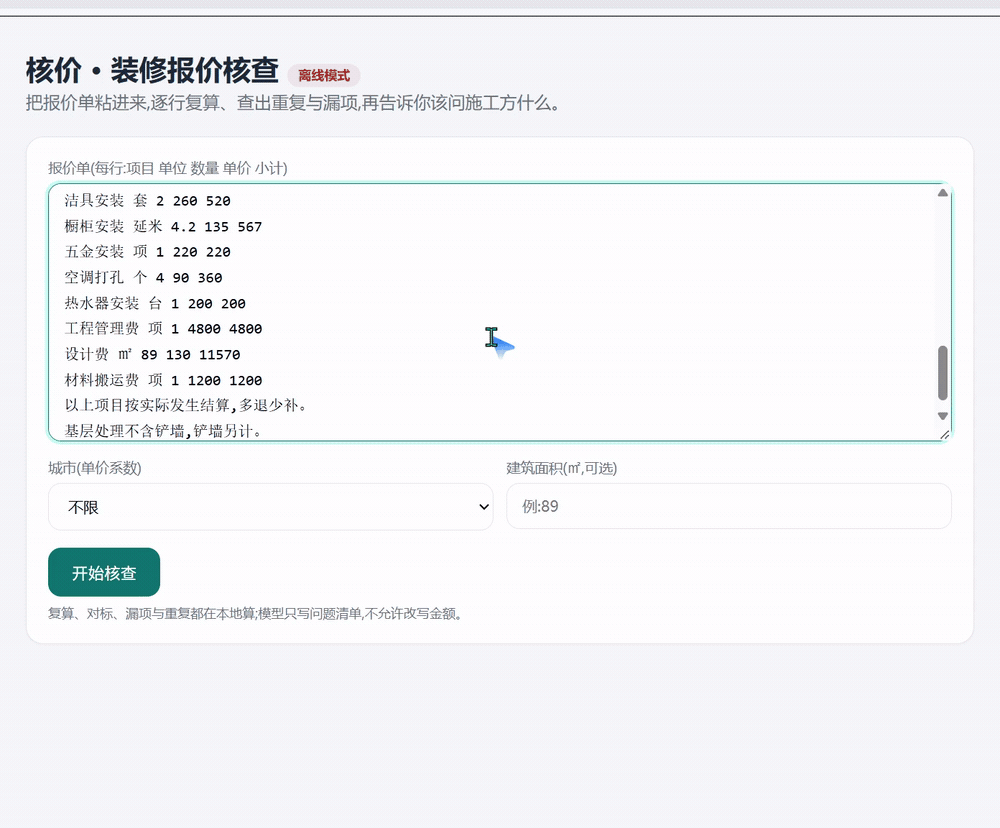
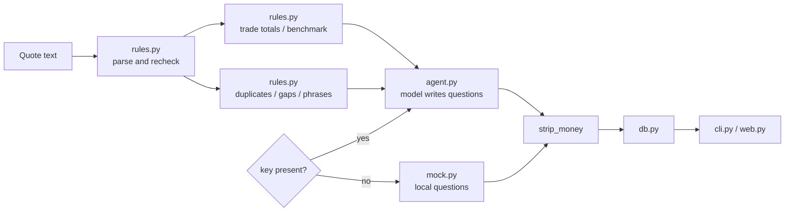

# HeJia · Renovation Quote Auditor

[](https://github.com/wushiyi105-jpg/hejia/actions) []() [](./LICENSE) [](https://codecov.io/gh/wushiyi105-jpg/hejia)



> Paste a renovation quote: recheck quantity × unit price line by line, benchmark each trade, find duplicated charges and missing items, then get the questions to ask the contractor.

The hard part of a renovation quote is that **every line looks fine**: unit prices sit inside a plausible range, subtotals look close enough, item names sound official. The overrun hides in phrases like "billed per item", "settled by actual quantity" and "base preparation". HeJia computes everything computable — arithmetic, unit normalisation, range comparison, missing items, duplicates — and leaves only "what to ask" to the model.

**CLI + Web, zero third-party dependencies.**

## ✨ Features

- 🧮 **Line-by-line recheck** — each line is `item unit qty price subtotal`; a mismatch prints the difference and the expected amount instead of silently fixing it
- 📐 **Unit normalisation** — 平方米/平米/㎡/m2 become ㎡, 米/延米/m become linear metres; "per item" and "per set" are flagged as vague pricing
- 💰 **Price benchmarking** — 34 trade/material ranges, adjusted by a city factor (Beijing 1.25, Chengdu 0.85), reported as a multiple of the band
- 🔍 **Duplicates and gaps** — items in the same trade whose names contain one another are duplicates; 26 standard items are checked for absence
- ❓ **Question list** — 30 vague phrases ("by actual quantity", "base preparation", "auxiliary materials extra") turned into concrete questions, each quoting the original text
- 📊 **Trade breakdown** — totals and shares by demolition / electrical / waterproofing / tiling / carpentry / painting / installation
- 🚩 **Settlement risks** — local issues summarised into the ways this quote becomes a change order after work starts
- 🔒 **Amounts are local-only** — the model writes text only; any "N yuan" in its output is stripped, and every amount comes from the local recomputation

## 🚀 Quick start

```bash
git clone https://github.com/wushiyi105-jpg/hejia.git
cd hejia

cp .env.example .env      # optional: LLM_API_KEY

python -m hejia audit --text "demolition ㎡ 12 45 540
bathroom waterproofing ㎡ 8 55 440" --city Chengdu --area 89
```

Or keep the quote in `quote.txt`, one item per line, then `python -m hejia audit --file quote.txt --save`.

Docker:

```bash
docker build -t hejia .
docker run -p 8000:8000 hejia

# or use the image published to GHCR on every tag
docker run -p 8000:8000 ghcr.io/wushiyi105-jpg/hejia:0.1.0
```

## 🧾 Examples

`examples/` ships four **real quotes with PII removed**, plus the **actual output** of running them (`examples/out/case-0N.md`, first line carries the command and date):

| File | Scenario | City / Area |
|---|---|---|
| `case-01.txt` | Full-renovation labour+aux quote, with a table header row | Beijing / 89 m2 |
| `case-02.txt` | Kitchen+bath partial job, lots of lump-sum lines | Chengdu / 68 m2 |
| `case-03.txt` | Large flat, unit prices uniformly high | Shenzhen / 120 m2 |
| `case-04.txt` | Rental turn, only 11 lines | Wuhan / 55 m2 |

```bash
python -m hejia --mock audit --file examples/case-01.txt --city 北京 --area 89
```

The output pins the numbers you can check by hand: 111502 total, 1253 per m2, the floor-tile line off by 184, wall tile billed twice, management fee 1.3x above range, 9 missing items. Details and known limits: [`examples/README.md`](examples/README.md).

## 🤔 Why not just ask a general LLM

A general model can read the quote and say "watch for change orders and double billing". HeJia adds the four things it cannot:

1. **The arithmetic can be verified** — `qty × price` versus `subtotal` is computed in Python; a 200 gap prints `+200.00` plus the expected amount. The same quote gives the same result twice, and 38 tests cover these formulas end to end. A general model does not multiply line by line, and cannot tell you which line is off.
2. **Amounts are not rewritten** — `agent.strip_money()` replaces "1800 yuan" in model output with a placeholder; questions stay textual and every number comes from the quote itself. "This looks about 300 too expensive" cannot be checked, and may simply be wrong.
3. **Works offline** — without a key, recomputation, benchmarking, duplicates, gaps, trade shares and the question list all run; a general chat model stops.
4. **Findings point at lines** — each issue carries a line number and the original text ("line 3, paint ㎡ 80 at 200, 5.2× the band ceiling"), each gap names the trade. A general model gives prose that cannot be traced to a row.

## 🎯 Use cases

- **Three quotes and no idea which to pick**: `audit --save` each, compare totals, trade shares and issue counts; the contractor whose unit prices differ most gets asked about material brands before you negotiate the total.
- **Before signing**: feed in "by actual quantity", "per item", "auxiliary materials extra" and work through the question list, asking for answers to be written into the quote so they cannot become change orders later.
- **Managing the site yourself**: check progress payments against trade shares, so a half-done electrical job does not get 60% of the money.

## 🗺 Roadmap

- **Compare several quotes**: turn saved records into a per-trade table showing the lowest/highest unit price and where the gap comes from.
- **Tie lines to rooms**: tag each line with kitchen/bathroom to summarise by space and catch duplicated area measurements.
- **Material brand library**: resolve "same brand, same model" to real models and market prices, so substitutions can be judged as downgrades.
- **Change-order ledger**: record added items during construction and track them against the contract total and original issues.
- **OCR input**: today the input must be one item per line; next is table-image recognition with explicit confirmation for uncertain rows.

## ❓ FAQ

**Where do I get an API key?**
The local parts — recomputation, benchmarking, gaps, duplicates, question list — need none. Only model-written questions and risks do; the default is DeepSeek (`https://api.deepseek.com`), set `LLM_API_KEY` in `.env` or pass `--api-key`.

**Where is data stored, and is it uploaded?**
`data/hejia.db` (override with `HEJIA_DB` or `--db`), holding totals, line counts, issue counts and the full detail JSON. A model call sends quote lines, local issues and vague phrases, never the database.

**Does it work without a key?**
Yes, with the same output structure: recheck table, trade shares, issues, question list and risks all present, only the questions come from local templates and the phrase library.

**How do I switch models?**
Set `LLM_BASE_URL`, `LLM_MODEL` and `LLM_API_KEY`, or override with `--model`.

**Can the model change amounts?**
No. Amounts exist only in the local recheck; model text passes through `strip_money`, and every "yuan" figure is replaced, so the question list never carries an amount.

## 📖 Commands

```bash
# 🧮 audit a quote
python -m hejia audit --text "..." --city Chengdu --area 89
python -m hejia audit --file quote.txt --save

# 💰 price ranges
python -m hejia prices --grep waterproof

# ✅ standard checklist (26 items)
python -m hejia checklist

# 🗂 saved quotes
python -m hejia history

# 🌐 web
python -m hejia web --port 8000

python -m hejia --json audit --text "..."   # raw JSON
python -m hejia --mock audit --text "..."   # force offline
```

## 🔌 Model configuration

Any **OpenAI-style `/chat/completions`** endpoint:

| Platform | `LLM_BASE_URL` | `LLM_MODEL` |
|---|---|---|
| DeepSeek (default) | `https://api.deepseek.com` | `deepseek-flash` |
| OpenAI | `https://api.openai.com/v1` | `gpt-4o-mini` |
| Local Ollama | `http://localhost:11434/v1` | `qwen2.5` |

## 🧠 How it works

```
quote text
  │
  ├─ rules.parse_lines ── parse each line → qty/price/subtotal/trade
  ├─ rules.summarize ──── total, trade shares, per sqm
  ├─ rules.benchmark ──── city factor × range → multiple
  ├─ rules.find_duplicates / find_missing ── duplicates and gaps
  ├─ rules.hit_vague ──── vague phrase hits
  │
  ├─ model: questions and risks (no amounts; strip_money filter)
  └─ offline: mock.py builds questions from local issues and phrases
  │
  └─ SQLite → CLI / Web
```

### Data flow



## 🗂 Layout

```
hejia/
├── hejia/
│   ├── rules.py    # parsing, recheck, units, benchmark, duplicates, gaps
│   ├── agent.py    # orchestration + amount stripping
│   ├── mock.py     # offline question list
│   ├── db.py       # saved quotes
│   ├── cli.py      # audit / prices / checklist / history / web
│   └── web.py      # single page + JSON API
├── data/
│   ├── prices.json    # 34 trade price ranges
│   ├── standard.json  # 26 standard items
│   └── vague.json     # 30 vague phrases
├── tests/
│   ├── test_hejia.py          # 26 offline unit tests
│   └── test_integration.py    # 12 HTTP / model-guard / CLI tests
├── examples/
│   ├── case-01..04.txt        # real quotes, PII removed
│   └── out/case-01..04.md     # actual output, command on line 1
└── assets/demo.gif
```

## ✅ Tests

```bash
python -m unittest discover tests -v
```

38 tests in three layers:

- **26 offline unit tests** — parsing, subtotal gaps, unit aliases, city factors, duplicates, gaps, trade classification, amount stripping.
- **4 HTTP integration tests** — a real `ThreadingHTTPServer` on a random port; POST `/api/audit` and assert total, per m2, line count, saved id; plus `404` and missing-area handling.
- **8 model-layer / CLI tests** — a fake OpenAI-compatible server returns a quote that is not in the document, a question carrying `2000 元`, and a fully-invalid list; the tests assert the quote is dropped, the amount becomes 该金额, and an all-invalid list yields an empty question list. CLI runs through `subprocess` asserting exit codes 0/2 and stderr text (missing file, non-UTF-8 file).

CI runs them on 3.10/3.11/3.12; on `v*` tags it also builds and pushes the image to GHCR.

## 👤 Author

Dazhao · 17382987315

## 📄 License

[MIT](./LICENSE)
