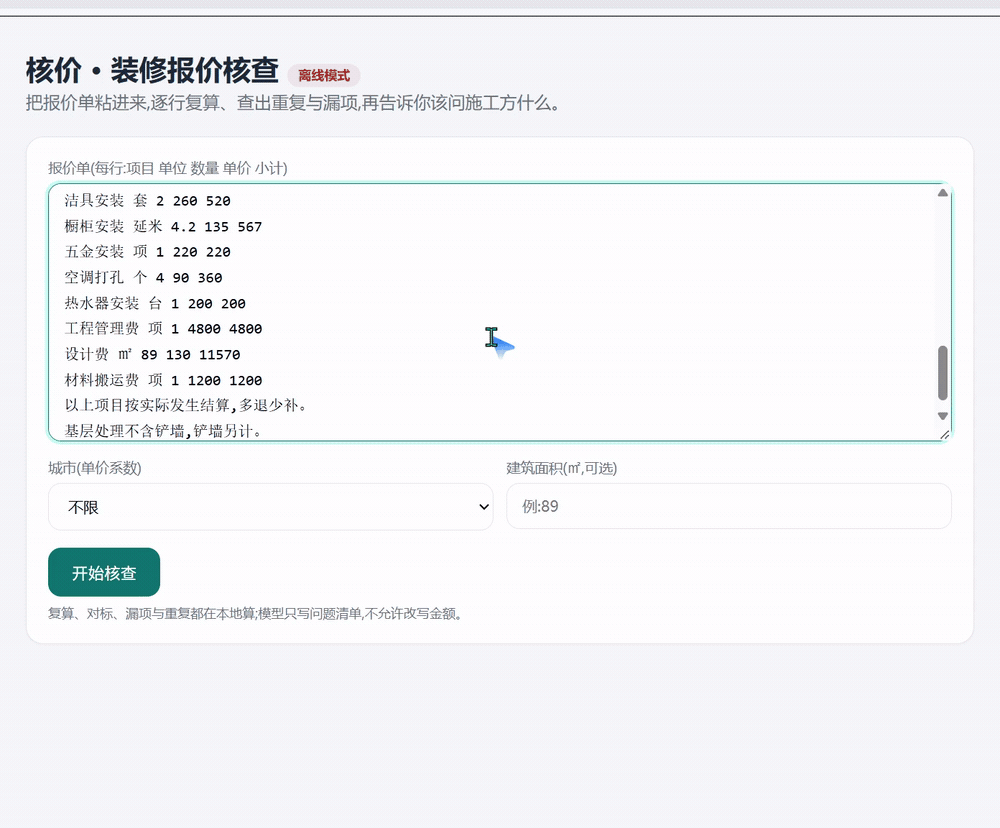
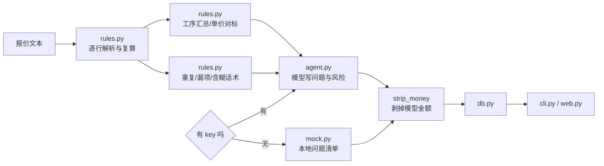

# 核价 HeJia · 装修报价核查 Agent

[](https://github.com/wushiyi105-jpg/hejia/actions) []() [](./LICENSE) [](https://codecov.io/gh/wushiyi105-jpg/hejia)



> 把装修报价单原样粘进来:逐行复算数量×单价、按工序对标单价、找出重复计费与漏项,再告诉你该问施工方什么。

装修报价单最麻烦的地方在于**它看起来每一行都对**:单价写在区间里,小计看着差不多,项目名似懂非懂。真正超支的部分往往藏在「按项报价」「按实际发生」「基层处理」这些词里。核价把能算的算死——复算、单位归一、区间对标、缺项、重复——只把「该怎么问」交给模型。

**CLI + Web 双入口,零第三方依赖。**

## ✨ 特性

- 🧮 **逐行复算** —— 每行「项目 单位 数量 单价 小计」,数量×单价≠小计直接标出差额与应有金额,不静默改数
- 📐 **单位归一** —— 平方米/平米/㎡/m2 统一成 ㎡,米/延米/m 统一成 延米;「按项」「按套」单独标为模糊计价
- 💰 **单价对标** —— 内置 34 条工序/材料单价区间,按城市系数(北京 1.25、成都 0.85 等)换算后给出倍数
- 🔍 **重复与漏项** —— 同工序下项目名互相包含即报重复;对照 26 条标准工序清单,列出没出现的子项
- ❓ **问题清单** —— 30 条含糊话术(按实际发生 / 基层处理 / 辅料另计)翻译成具体追问,每条挂原文
- 📊 **工序占比** —— 按拆改/水电/防水/瓦工/木工/油漆/安装汇总金额与占比,一眼看出钱花在哪
- 🚩 **结算风险** —— 由本地疑点归纳出「进场后容易变增项」的几条,签字前先问清
- 🔒 **金额只信本地** —— 模型只写文字,输出里的「xx 元」会被剥掉;所有金额以复算结果为准

## 🚀 快速开始

```bash
git clone https://github.com/wushiyi105-jpg/hejia.git
cd hejia

cp .env.example .env      # 可选:填 LLM_API_KEY

python -m hejia audit --text "拆除墙体 ㎡ 12 45 540
卫生间防水 ㎡ 8 55 440
墙砖铺贴 ㎡ 25 65 1625" --city 成都 --area 89
```

也可以把报价单存成 `报价.txt`,一行一项,然后 `python -m hejia audit --file 报价.txt --save`。

Docker 运行:

```bash
docker build -t hejia .
docker run -p 8000:8000 hejia

# 或者直接用镜像(打 tag 后自动推到 GHCR)
docker run -p 8000:8000 ghcr.io/wushiyi105-jpg/hejia:0.1.0
```

## 🧾 示例

`examples/` 里有四份**真实报价单脱敏**后的文本,以及它们**实跑输出**(`examples/out/case-0N.md`,第一行写着生成命令与运行日期):

| 文件 | 场景 | 城市 / 面积 |
|---|---|---|
| `case-01.txt` | 老房整体翻新半包,表格带表头 | 北京 / 89 ㎡ |
| `case-02.txt` | 厨卫局部改造,一堆"按项" | 成都 / 68 ㎡ |
| `case-03.txt` | 大平层半包,单价整体偏高 | 深圳 / 120 ㎡ |
| `case-04.txt` | 出租房简装,只有 11 行 | 武汉 / 55 ㎡ |

```bash
python -m hejia --mock audit --file examples/case-01.txt --city 北京 --area 89
```

输出里能直接看到:合计 111502 元、1253 元/㎡、地砖那行小计多算 184、墙砖铺贴重复计费、管理费高于区间 1.3 倍、9 处漏项。细节与已知口径边界见 [`examples/README.md`](examples/README.md)。

## 🤔 为什么不用通用大模型直接问

通用模型能读完报价单说「注意增项和重复计费」,但核价补的是它做不到的四件事:

1. **复算可验证** —— 每行 `数量×单价` 与 `小计` 的差额由 Python 算,差 200 就显示 `+200.00` 并给出应有金额;同一份报价跑两次结果一致,38 个测试覆盖这些公式与整条链路。通用模型不会逐行做乘法,更不会告诉你差在哪一行。
2. **金额不接受改写** —— `agent.strip_money()` 会把模型输出里的「1800 元」换成「该金额」,问题清单只用文字;所有数字来自报价单本身。通用模型一句「这项大概贵了三百」既无法核对,也可能算错。
3. **离线可用** —— 没配 key 时复算、对标、重复、漏项、工序占比、问题清单全部照跑;通用对话离线就断。
4. **结论回指原行** —— 每条疑点带行号与原文(第 3 行「乳胶漆 ㎡ 80 200」高于区间上限 5.2 倍),每条漏项指到具体工序。通用模型给的是段落式建议,落不到行。

## 🎯 适用场景

- **收到三份报价不知道选哪份**:分别 `audit --save`,看合计、工序占比与疑点数;同一工序单价差得多的那家,先问材料品牌而不是直接砍总价。
- **准备签合同前**:把「按实际发生」「按项」「辅料另计」这类句子喂进去,拿问题清单逐条问,并要求把答案写进报价单,避免进场后变增项。
- **自己盯工地**:按工序占比核对进度款,水电做到一半就付了 60% 的情况能提前看出来。

## 🗺 Roadmap

- **多份报价并排对比**:把 `--save` 的记录按工序拉成对比表,同一项目标出最低/最高单价与差额来源。
- **报价单与图纸关联**:支持给每行标房间(厨房/卫生间),按空间汇总,便于核对面积是否重复计算。
- **材料品牌库**:把「同品牌同型号」落到具体型号与市场价,判断替换是否降配。
- **增项台账**:施工过程中新增项目逐条录入,实时对照合同总价与原疑点,防止结算翻倍。
- **OCR 录入报价单**:现在要求一行一项的文本,下一步支持表格图片识别后再人工确认,识别不确定的行明确标出。

## ❓ FAQ

**API key 从哪来?**
复算、对标、漏项、重复、问题清单的本地部分都不需要 key。只有模型撰写的问题与风险提示需要,默认接 DeepSeek(`https://api.deepseek.com`),填 `.env` 的 `LLM_API_KEY` 或用 `--api-key`。

**数据存在哪,会不会上传?**
`data/hejia.db`(可用 `HEJIA_DB` 或 `--db` 换),存合计、行数、疑点数与完整明细 JSON。调模型时只发报价行、本地疑点与含糊话术,不发数据库。

**没有 key 还能用吗?**
能,输出结构与有 key 时一致:复算表、工序占比、疑点、问题清单、风险提示都在,只是问题由本地模板与话术库生成。

**怎么换模型?**
改 `LLM_BASE_URL`、`LLM_MODEL`、`LLM_API_KEY`,或用 `--model` 临时覆盖。

**模型会不会改动金额?**
不会。金额只出现在本地复算结果里;模型返回的文字经过 `strip_money`,任何「元/块」金额都被替换掉,问题清单里也不会出现金额。

## 📖 命令参考

```bash
# 🧮 核查报价单
python -m hejia audit --text "..." --city 成都 --area 89
python -m hejia audit --file 报价.txt --save

# 💰 工序单价区间
python -m hejia prices --grep 防水

# ✅ 标准工序检查清单(26 项)
python -m hejia checklist

# 🗂 存过的报价
python -m hejia history

# 🌐 Web
python -m hejia web --port 8000

python -m hejia --json audit --text "..."   # 原始 JSON
python -m hejia --mock audit --text "..."   # 强制离线
```

## 🔌 模型接入

任意 **OpenAI 风格 `/chat/completions`** 接口:

| 平台 | `LLM_BASE_URL` | `LLM_MODEL` |
|---|---|---|
| DeepSeek(默认) | `https://api.deepseek.com` | `deepseek-flash` |
| OpenAI | `https://api.openai.com/v1` | `gpt-4o-mini` |
| 本地 Ollama | `http://localhost:11434/v1` | `qwen2.5` |

## 🧠 工作原理

```
报价文本
  │
  ├─ rules.parse_lines ── 逐行解析 → 数量/单价/小计/工序
  ├─ rules.summarize ──── 合计、工序占比、元/㎡
  ├─ rules.benchmark ──── 城市系数 × 区间,给出倍数
  ├─ rules.find_duplicates / find_missing ── 重复与漏项
  ├─ rules.hit_vague ──── 含糊话术命中
  │
  ├─ 模型:问题清单与风险(禁止金额,strip_money 过滤)
  └─ 离线:mock.py 用本地疑点与话术库拼问题
  │
  └─ SQLite → CLI / Web
```

### 数据流



## 🗂 目录结构

```
hejia/
├── hejia/
│   ├── rules.py    # 解析、复算、单位归一、对标、重复、漏项
│   ├── agent.py    # 编排 + 金额剥离
│   ├── mock.py     # 离线问题清单
│   ├── db.py       # 报价记录
│   ├── cli.py      # audit / prices / checklist / history / web
│   └── web.py      # 单页 + JSON API
├── data/
│   ├── prices.json    # 34 条工序单价区间
│   ├── standard.json  # 26 项标准工序清单
│   └── vague.json     # 30 条含糊话术
├── tests/
│   ├── test_hejia.py          # 26 个离线单测(解析/复算/对标/重复/漏项/归类)
│   └── test_integration.py    # 12 个集成(HTTP、假模型守卫、CLI 子进程)
├── examples/
│   ├── case-01..04.txt        # 真实报价单脱敏
│   └── out/case-01..04.md     # 实跑输出,首行写生成命令
└── assets/demo.gif
```

## ✅ 测试

```bash
python -m unittest discover tests -v
```

分三层,共 38 个用例:

- **26 个离线单测** —— 解析、复算差额、单位归一、城市系数、重复、漏项、工序归类、金额剥离。纯函数,毫秒级。
- **4 个 HTTP 集成** —— 真起 `ThreadingHTTPServer` 在随机端口,POST `/api/audit` 后断言合计、元/㎡、行数、入库 ID;并校验 `404`、面积缺省。
- **8 个模型层 / CLI 集成** —— 本地起一个假的 OpenAI 兼容服务,喂回「报价单里没有的引用」「含 2000 元的提问」「全被剥掉的清单」,断言引用被丢弃、金额被换成「该金额」、全丢时问题清单为空;CLI 用 `subprocess` 断言退出码 0/2 与 stderr 文案(读不到文件、非 UTF-8)。

CI 在 3.10/3.11/3.12 上跑同一组,打 `v*` tag 时额外构建并推送镜像到 GHCR。

## 👤 作者

大钊 · 17382987315

## 📄 License

[MIT](./LICENSE)
